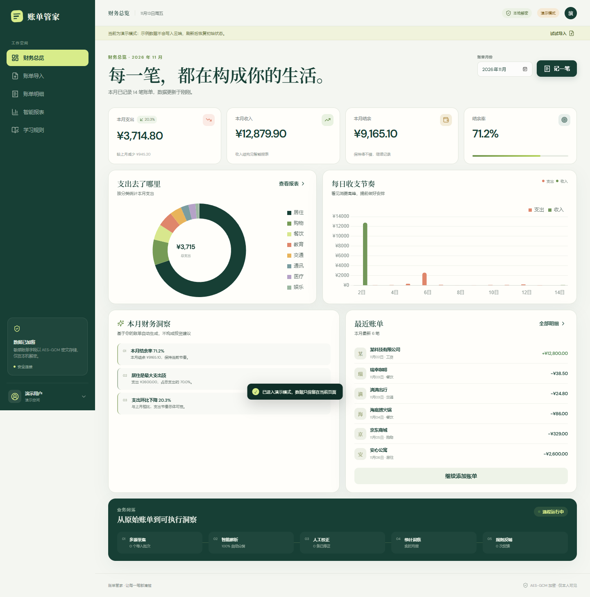

# 账单管家 Bill Insight

多源账单采集、智能分类、月度分析与反馈学习一体化个人财务系统。

项目面向个人账单“来源散、格式乱、隐私敏感、统计麻烦”的问题，提供从截图/表格到分类、入账、图表、修正、规则反哺的完整闭环。无需付费 OCR，也不依赖支付平台开放接口。



## 已实现功能

- **多源采集**：支付宝/微信/银行流水 CSV、XLS、XLSX，账单截图 OCR，手动记账。
- **OCR 本地识别**：Tesseract.js + 内置 `chi_sim` 模型，不上传截图；支持单笔支付详情和账单列表截图，列表可一次识别多条并忽略汇总金额。
- **智能分类**：覆盖 11 类支出、6 类收入的内置规则；低置信度明确标记，入账前逐条可编辑。
- **反馈学习**：人工修改分类后，自动提取商户关键词生成个人规则，并在后续账单中优先命中；记录修改前后反馈事件。
- **导入可靠性**：批次记录、失败行提示、重复账单跳过、CSV 编码兼容、非法日期拦截。
- **统计报表**：月度收入/支出/结余、分类占比环图、每日收支、近六月趋势、自动洞察、分类排行、Excel/HTML 导出与分享。
- **安全存储**：金额、商户、备注、OCR 原文使用 AES-GCM 加密；云端 RLS 按账号隔离，本地模式将密文写入本机 `data/vault.json`，换端口、换浏览器或重启后均可恢复。
- **两种运行模式**：本地独立模式（无账号、离线、可 Docker 部署）与 WorkBuddy 云端模式（跨设备、真实账号）。
- **响应式界面**：桌面与手机端自适应，空状态、错误状态和操作确认完整。

## 快速开始

环境要求：Node.js 20.19+（推荐 22），npm 10+。

```bash
npm install
npm run dev
```

Windows 用户也可以直接双击项目根目录的 `start-dev.bat`，脚本会自动寻找本机 Node.js、进入项目并启动浏览器。

打开 `http://127.0.0.1:5173`：

- **本地独立模式**：首次设置至少 8 位加密口令，密文保存到项目 `data/vault.json`，可离线使用；更换端口或重启服务不影响数据。
- **快速体验演示数据**：无需口令，内置近两月样例账单；修改仅保留在当前页面。
- **使用 WorkBuddy 登录**：需要部署到已授权的线上域名，用于跨设备云端存储。本地开发建议用前两种模式。

生产构建和本地预览：

```bash
npm run build
npm run preview
```

## Docker 独立部署

```bash
docker compose up -d --build
```

打开 `http://localhost:8080`，选择“本地独立模式”。Node 服务同时提供页面、同源保存接口和本地保险箱，账单密文保存在 Docker 命名卷 `bill_insight_data` 中。备份数据：

```bash
docker cp bill-insight:/app/data/vault.json ./vault-backup.json
```

不使用 Compose 时：

```bash
docker build -t bill-insight .
docker run -d --name bill-insight -p 8080:80 --restart unless-stopped bill-insight
curl http://localhost:8080/health
```

## 使用流程

1. 进入“账单导入”，上传 `public/samples/` 中的样例文件或一张支付详情截图。
2. 核对自动解析的日期、商户、金额、收支和分类，修正低置信度项目。
3. 点击“确认入账”，系统加密保存并记录导入批次。
4. 在“账单明细”直接修改分类，系统生成学习规则。
5. 在“学习规则”查看规则权重、命中次数和反馈历史。
6. 在“智能报表”查看图表，导出 Excel 或 HTML 月报。

本地模式下所有账单保存在项目目录：

```text
data/vault.json
```

直接复制该文件即可备份，最新一次写入前的版本会保留在 `data/vault.json.bak`。恢复时把备份文件改名为 `vault.json` 放回 `data/`，再使用原加密口令解锁。

样例文件：

- `public/samples/alipay-demo.csv`
- `public/samples/wechat-demo.xlsx`
- `public/samples/wechat-ocr-demo.png`（可直接用于截图 OCR）

## 测试与构建

```bash
npm test
npm run build
```

当前结果：15 项核心单元测试全部通过；生产依赖审计 0 个已知漏洞；TypeScript 严格模式构建通过。

已通过真实浏览器完成的主流程验证：

- 首次创建本地保险箱并导入 5 条 CSV 账单；
- OCR 识别 PNG 截图并生成可编辑预览；支付详情含“查看退款详情”时不会误判为收入；
- 用真实微信账单列表截图一次识别 9 条，日期、商户、金额正确，并忽略“支出 1346.91”汇总行；
- Excel 文件解析 4 条账单；
- 修改分类后出现 1 条新规则、1 条反馈，修正状态正确；
- 刷新后本地数据保留，错误口令无法解锁；
- 直接读取 `vault.json` 检查，明文商户和金额不存在；
- 关闭页面后换到另一端口重新解锁，5 条账单全部保留；
- 桌面与 390px 移动端无页面异常，控制台无报错；
- 直接静态访问 `dist/index.html`，图表、样例文件和本地 OCR 模型均可加载。

## 技术栈

- React 19 + TypeScript + Vite
- Chart.js + react-chartjs-2
- Tesseract.js（OCR）与本地 `chi_sim` 模型
- SheetJS 0.20.3（表格导入导出）
- Web Crypto API（PBKDF2 + AES-256-GCM）
- WorkBuddy Cloud Service（可选云端持久化、WorkBuddy 账号登录、RLS）
- Node HTTP Server + Docker（同源保存接口与独立部署）

## 目录

```text
src/
  components/       页面与图表组件
  lib/              解析、分类、加密、统计、数据存储
  test/             核心单元测试
server/             本机文件保险箱接口
server.mjs          生产静态服务与 API 服务
data/               本地加密保险箱（运行时生成，不提交）
public/
  samples/          可直接导入的演示账单
  tessdata/         本地中文 OCR 模型
docs/
  初赛作品设计文档.md
  演示视频脚本.md
  screenshots/      功能截图
Dockerfile
docker-compose.yml
```

## 设计边界

- 图片越清晰，OCR 准确率越高；系统不把 OCR 结果直接入账，必须经人工确认。
- 当前分类器是可解释的关键词规则与反馈学习，不宣称使用大模型；低置信度数据显式暴露给用户。
- 未接入支付宝/微信私有 API，也不保存支付密码。RPA 作为可选扩展，遇到验证码或页面变化时应转人工。
- 本地模式的数据文件是本机 `data/vault.json`，默认只绑定 `127.0.0.1`；可通过复制 `data` 目录备份，但不自动跨设备同步。跨设备请使用云端模式。
- 云端模式依赖已激活的 WorkBuddy 云服务，授权域名下登录；Docker 部署可使用完整的本地模式。

更多设计细节见 [初赛作品设计文档](docs/初赛作品设计文档.md)。
