# 账单管家（Bill Insight）初赛作品设计文档

> 作品方向：个人财务 · 多源账单智能管理  
> 作品形态：响应式 Web 应用，支持本地独立部署与云端跨设备使用  
> 核心闭环：多源采集 → 智能解析 → 人工校正 → 加密入账 → 统计报表 → 反馈学习

## 一、作品简介

账单管家是一款面向个人用户的智能账单管理应用。它把支付宝、微信支付、银行导出的 CSV/Excel 文件，以及支付详情截图，统一转化为日期、收支、金额、商户、分类等结构化账单；通过内置分类知识库自动归类，允许用户在入账前和入账后修正；修正结果会沉淀为可复用的个人关键词规则，优先应用于后续相似账单。

系统同时提供月度收支总览、分类占比环图、每日收支、近六月趋势、自动财务洞察、分类排行，以及 Excel 与 HTML 月报导出。所有金额、商户、备注和 OCR 原文均先在浏览器端加密再持久化，云端使用行级安全策略按账号隔离。除云端模式外，项目还提供无账号、可离线、可 Docker 独立部署的本地加密模式，避免核心体验依赖第三方付费能力。

### 提交版简介（可直接粘贴）

账单管家聚焦个人账单“来源分散、格式混乱、隐私敏感、统计低效”的问题，构建了从多源采集到反馈学习的完整闭环。系统支持 CSV/Excel 导入、支付截图 OCR 和手动记账，自动识别日期、收支、金额、商户与分类；通过“内置规则 + 个人反馈规则”实现可解释的智能分类，用户每次修正都会形成后续可复用的关键词规则，并保留完整反馈记录。系统提供月度收支、分类占比、每日趋势、自动洞察与报表导出，并采用 AES-GCM 对敏感字段加密，云端以 RLS 隔离账号，另提供无需账号、可离线与 Docker 独立部署的本地模式。作品不依赖付费 OCR 或支付平台私有接口，强调隐私、可靠与可迁移。

## 二、选题背景与问题分析

### 2.1 用户痛点

个人账单往往分散在支付宝、微信、银行卡、电商平台和线下支付截图中。用户真正需要回答的问题不是“这笔钱从哪里扣的”，而是“钱花到哪里了、是否超支、下个月怎么调整”。现有工具存在以下断点：

1. **采集成本高**：不同平台字段命名、编码、导出格式不一致，手工录入耗时。
2. **自动分类不准且不可解释**：固定分类无法适应个人习惯，错误分类不能沉淀为经验。
3. **隐私风险**：账单包含商户、金额、时间和消费偏好，上传第三方 OCR 或财务 App 存在数据外流风险。
4. **统计与行动脱节**：只有流水列表，没有月度趋势、分类占比和可执行洞察。
5. **部署依赖重**：大量产品绑定账号、订阅或第三方服务，难以独立部署和验证。

### 2.2 目标用户

- 希望建立月度预算习惯、但不想手工记账的年轻职场人；
- 对财务隐私敏感、希望数据由自己控制的用户；
- 需要快速整理报销或家庭账单的学生、自由职业者与家庭用户；
- 希望验证完整业务闭环的产品评审与比赛评委。

### 2.3 设计目标

| 目标 | 可验证结果 |
|---|---|
| 降低采集成本 | 一份标准 CSV 或截图可解析为可编辑账单；重复账单自动跳过 |
| 分类可解释、可进化 | 每次显示置信度；修正后产生规则与反馈记录，后续账单命中 |
| 隐私优先 | 云端数据库和本地 `vault.json` 中无明文商户/金额；错误口令无法解锁 |
| 统计有价值 | 月度收支、分类环图、每日趋势、近六月趋势和文字洞察可用 |
| 工程可交付 | 严格类型检查、单元测试、生产构建、Docker 文件齐全 |
| 独立可运行 | 无账号本地模式可完成导入、入账、报表、刷新持久化 |

## 三、创新点与差异化

### 3.1 人机协同的反馈学习，而不是黑盒“智能”

系统不把自动分类当作最终结论。每条预览账单都展示置信度，低于 50% 明确标记“待核对”。用户修正分类后：

1. 保存修改前后分类，形成 `feedback_events` 审计记录；
2. 清洗商户名称中的“扫码支付、快捷支付、订单”等噪声，提取稳定关键词；
3. 生成个人规则，权重 100，高于内置规则；
4. 再次修改同一关键词时，规则命中次数与权重增加；
5. 后续导入时先匹配个人规则，再匹配内置规则，最后使用收支兜底分类。

这一机制把“一次修正”转化为“长期能力”，并且全过程可解释、可查看、可追踪，符合个人财务管理对确定性的要求。

### 3.2 隐私优先的双运行模式

多数同类作品默认把全部账单上传服务器。本项目提供两条能力一致的数据路径：

- **云端模式**：WorkBuddy 账号登录，云端数据库按 `owner_id = auth.uid()` 做行级隔离，适合跨设备。
- **本地模式**：无需账号，账单加密后由本机 Node 服务写入 `data/vault.json`，可离线、可 Docker 独立部署；更换端口、浏览器或重启后均可恢复，适合单机与隐私敏感用户。

两种模式使用同一套加解密、分类、报表和界面逻辑，避免“演示版能跑、部署版不能跑”。本地不是云端失败后的静默降级，而是用户明确选择的正式模式。

### 3.3 OCR 本地化，减少外部依赖

截图识别使用浏览器内 Tesseract.js，并将 2.4 MB 的 `chi_sim` 快速模型随应用发布。图片不会上传，识别不依赖付费接口；首次使用也不需要从公共模型站下载数十 MB 数据。OCR 结果必须进入可编辑预览，避免识别误差直接污染账本。

### 3.4 可靠导入而非“上传即成功”

- 自动寻找表头行，兼容支付宝、微信、银行常见中文字段；
- UTF-8 与 GB18030 编码兼容；
- 校验非法日期（例如 2 月 30 日），不会静默滚到 3 月；
- 空金额、零金额、无效行单独计数并提示；
- 基于日期、收支、金额、商户生成 SHA-256 指纹，重复导入自动跳过；
- 每次导入生成批次，记录总数、成功数、异常/重复数和错误摘要，支持追责与回放。

### 3.5 面向评审的可演示性

- 一键进入内置两月样例数据的演示模式，不依赖账号；
- 现场修改一条分类，切到“学习规则”即可看到规则和反馈；
- 导入预览、批次状态、报表、加密说明均有可见证据；
- 桌面与移动端均可展示。

## 四、系统架构

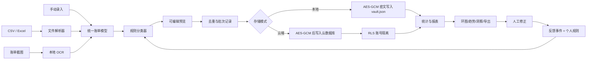

### 4.1 技术栈

| 层 | 技术 | 选择理由 |
|---|---|---|
| 前端 | React 19、TypeScript、Vite | 组件化、类型安全、构建快，便于拆分页面 |
| 图表 | Chart.js、react-chartjs-2 | 体积适中，环图/柱图满足报表需求 |
| 文件 | SheetJS 0.20.3 | 同时处理 CSV、XLS、XLSX，浏览器端运行 |
| OCR | Tesseract.js 6、本地 chi_sim 模型 | 图片不出浏览器，无付费 API |
| 加密 | Web Crypto：PBKDF2-SHA256 + AES-256-GCM | 浏览器原生、认证加密、无需额外库 |
| 本地存储 | Node HTTP API + 文件 | 密文写入 `data/vault.json`，与浏览器、端口解耦，原子写入并保留上一版备份 |
| 云端 | WorkBuddy Cloud Service | 托管数据库和账号能力，RLS 隔离 |
| 部署 | Node 多阶段 Docker | 同源页面与保存接口、命名卷持久化、健康检查 |

### 4.2 分层说明

- **采集层**：文件解析、OCR、手动表单，统一输出 `DraftTransaction`。
- **智能层**：`classifier.ts` 负责内置规则、个人规则和置信度；`stats.ts` 负责聚合与洞察。
- **安全层**：`crypto.ts` 负责密钥派生和字段加解密；`store.ts` / `localStore.ts` 负责两条持久化路径；`server/vault.js` 只接收并原子保存密文。本地页面和服务同源，保存接口默认只监听 `127.0.0.1`。
- **展示层**：总览、导入、明细、报表、学习规则五个页面。
- **反馈层**：分类修改同时更新账单、规则和反馈事件。

## 五、功能设计

### 5.1 多源账单采集

**文件导入**：用户拖入或选择 CSV/XLS/XLSX。解析器先扫描前若干行寻找同时包含日期和金额列的表头，再根据别名匹配商户、收支、备注列。日期支持 `2026-11-03`、`2026/11/03`、`2026年11月3日`、Excel 日期序列；金额支持千分位、货币符号、括号负数。不可识别的行记录行号，不阻塞其他有效行。

**截图 OCR**：上传 PNG/JPG/WEBP/BMP，本地放大、灰度增强并二值化后识别，浅灰色日期行的可见度明显提高；用户可直接修改 OCR 原文再解析。解析器同时支持两类版式：

- 单笔支付详情：优先选择带“实付/付款/合计”或 `¥` 的金额，过滤优惠、手续费和“查看退款详情”等干扰。
- 账单列表：逐行匹配带正负号的金额，关联相邻日期，过滤“支出合计/收入合计”，一次生成多条可编辑账单并按商户独立分类。

图片与原文不上传。

**手动记账**：日期、商户、金额、收支、备注五字段，同样走分类器与预览，不只保存裸数据。

### 5.2 自动分类与人工确认

内置知识库覆盖餐饮、交通、购物、居住、医疗、教育、娱乐、通讯、旅行、人情、其他支出，以及工资、奖金、退款、投资、转账、其他收入。预览表允许修改日期、商户、金额、收支和分类；切换收支时同步切换可选分类。用户确认后才生成正式账单。

### 5.3 账单明细与反馈学习

明细页支持按月份/全部时间、收支、分类、关键词筛选，分页显示来源、金额、分类与学习状态。用户点击分类下拉框即可修改：

- 状态变为“已反哺”；
- 生成 `old_category → new_category` 反馈；
- 新增或加强个人规则；
- 后续导入时显示“规则命中”。

学习规则页展示规则关键词、目标分类、收支方向、命中次数、权重，以及最近反馈历史。规则按“权重 + 关键词长度 + 命中次数对数”动态排序。

### 5.4 月度统计与报表

- 核心指标：收入、支出、结余、结余率、支出环比；
- 支出分类环图与图例；
- 每日收入/支出柱图；
- 近六个月支出趋势；
- 自动洞察：结余率、最大支出分类、环比变化；
- 分类排行：金额、占比、进度条；
- 导出：XLSX 明细、可打印 HTML 月报、系统分享或复制摘要。

报表数据完全由当前用户已入账账单计算；退款计入收入，重复账单在入账时已排除。

### 5.5 导入批次与异常追踪

批次字段包括来源、文件名、状态、总行数、成功数、异常/重复数、错误摘要和时间。导入过程先创建 `processing` 批次，成功后更新为 `completed`，异常时更新为 `failed`。即使发生部分失败，也能看到影响范围。

### 5.6 RPA / API 扩展设计（可选，不冒充已接入）

本项目未接入支付宝或微信私有 API，也未保存支付密码。可选扩展路径：

1. 使用 Power Automate 等 RPA 工具在用户已登录的浏览器中打开账单页；
2. 用户本人完成登录、验证码和二次确认；
3. 选择时间范围并导出官方 CSV；
4. RPA 将文件放入约定目录，本系统负责解析、分类和入账。

边界：页面结构变化、验证码、风控挑战时立即停止并转人工；RPA 脚本不保存支付密码；不绕过平台授权。当前产品已覆盖“拿到文件之后”的全部可靠性工作，因此接入 RPA 只需替换采集入口。

## 六、关键流程

### 6.1 导入与入账

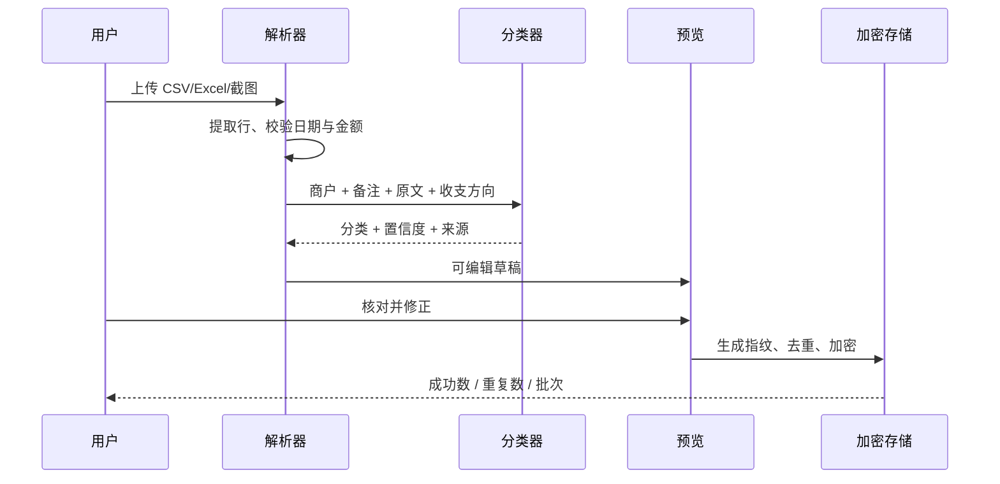

### 6.2 反馈闭环

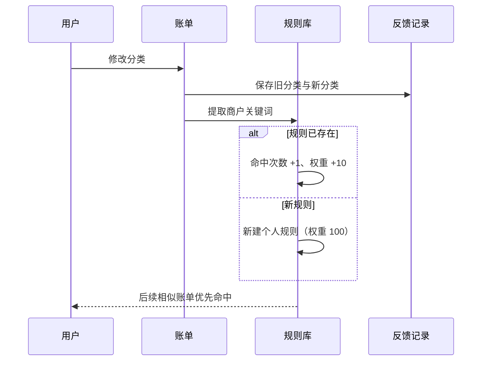

### 6.3 分类算法

个人规则得分：

```text
score = weight + keyword_length × 2 + log2(hit_count + 1)
```

按得分降序取第一条命中规则，置信度 0.99。若无个人规则，则对内置关键词做包含匹配；命中时置信度在 0.72–0.95 之间；无命中时按收支方向归入“其他支出/其他收入”，置信度 0.3，并在预览中提示“待核对”。

该算法不是大模型，但具备三个优点：离线、无调用成本、结果可解释。对个人账单这种类别有限、商户重复率高的场景，比通用模型更稳定，也能通过反馈持续个性化。

## 七、数据模型

### 7.1 主要实体

| 实体 | 关键字段 | 用途 |
|---|---|---|
| transactions | occurred_on, month, direction, category, original_category, category_source, confidence, payload_iv/data, fingerprint, corrected, batch_id | 正式账单；敏感载荷加密 |
| category_rules | keyword_iv/data, category, direction, weight, hit_count | 个人学习规则 |
| import_batches | source, file_name, status, total/success/failed_count, error_summary | 导入批次追踪 |
| feedback_events | transaction_id, old_category, new_category | 分类修正审计 |
| user_settings | salt, verifier_iv/data | 加密盐与口令校验 |

### 7.2 去重指纹

```text
SHA-256(occurred_on | direction | amount.toFixed(2) | merchant.trim().toLowerCase())
```

同一用户下 `(owner_id, fingerprint)` 唯一。重复导入使用 `upsert + ignoreDuplicates`，不覆盖用户已修改的分类。该设计保证重复文件不会制造重复统计，同时保留原账单。

## 八、安全与隐私设计

### 8.1 加密流程

1. 首次设置至少 8 位口令；
2. 生成 16 字节随机盐；
3. PBKDF2-SHA256 迭代 150,000 次派生 AES-256 密钥；
4. 用 AES-GCM 加密校验值，验证口令是否正确；
5. 每笔载荷使用独立 12 字节随机 IV 加密；
6. 云端数据库仅保存 IV、密文、日期、分类等最小检索字段；本地模式把整份加密载荷写入 `data/vault.json`；
7. 退出后内存密钥销毁，刷新后需重新输入口令。

金额、商户、备注、OCR 原文在云端和本地均不落明文。本地保存接口没有解密能力，即使读取数据文件也无法获得口令。文件采用“临时文件 + rename”原子写入，并保留上一版 `.bak`，降低异常断电造成损坏的风险。分类、日期和收支方向在云端保留为明文，用于服务端检索与渲染骨架；这些字段单独泄露不足以还原完整消费行为。

### 8.2 账号隔离

云端所有用户数据表均启用 RLS，策略为：

```sql
owner_id = auth.uid()
```

插入时 `owner_id` 由数据库默认值填充，前端不传 owner；更新同时使用 `USING` 与 `WITH CHECK`，防止把数据改归他人。应用只向 `authenticated` 角色授权，未登录请求无法读取业务表。

### 8.3 其他措施

- 文件名、金额、日期在解析前校验类型与长度；上传限制 10 MB/8 MB；
- 页面不打印原始账单行、令牌、密钥；
- 删除账单需要用户在界面明确确认；
- 分享月报仅包含汇总与洞察，不含商户和明细；
- 生产依赖安全审计为 0 个已知漏洞（2026-11-13）；
- Docker 响应头包含 nosniff、SAMEORIGIN、Referrer-Policy 与权限策略。

## 九、部署方案

### 9.1 本地开发

```bash
npm install
npm run dev
```

### 9.2 Docker 独立部署

```bash
docker compose up -d --build
# 访问 http://localhost:8080
```

多阶段构建先在 Node 22 中执行类型检查和生产构建，运行阶段由 `server.mjs` 同时提供静态页面、`/api/vault` 本地保险箱和 `/health` 健康检查。容器暴露 8080 端口，账单密文持久化到 Docker 命名卷 `bill_insight_data`，容器重建不会丢数据。本地模式无需额外数据库、无需外网 API。

说明：当前开发机未安装 Docker，因此 Dockerfile 已完成构建逻辑和安全配置，但未在本机实际启动容器验证；Node 生产构建与浏览器端流程已实测。部署到 Docker 后建议执行 `curl /health` 并完成一次本地导入闭环。

### 9.3 云端模式

云端模式依赖 WorkBuddy 云服务环境与账号登录，需部署到授权域名。数据结构已通过 SQL 迁移创建：5 张业务表、RLS 策略、唯一指纹索引和月份索引。云端和本地共用前端构建产物，无需维护两套页面。

## 十、测试与验证

### 10.1 自动化测试（15/15 通过）

| 用例 | 验证点 |
|---|---|
| CSV 解析 | BOM、中文表头、千分位金额、收入/支出识别 |
| 非法行 | 非日期、2 月 30 日、零金额均被拒绝并提示 |
| OCR 文本 | 日期、商户、金额、餐饮分类 |
| OCR 空结果 | 返回可操作错误而非空成功 |
| 支付详情方向 | 普通支付页出现“查看退款详情”时仍判为支出 |
| 退款语义 | 只有“退款成功/已退款到账”才判为收入 |
| OCR 金额选择 | 多金额时优先“实付金额”，相同金额去重 |
| 账单列表 | 一次解析 9 行商户/日期/金额，并忽略“支出合计” |
| 重复金额 | 列表中两家商户各消费 10 元时保留为两条账单 |
| 分类规则 | 个人规则覆盖内置规则 |
| 反馈学习 | 新规则生成、重复修正权重和命中数增长 |
| 关键词清洗 | 去除“扫码支付”等噪声 |
| 月度统计 | 收支、结余、分类排序、日趋势 |
| 加密 | 正确口令往返；错误口令无法解锁 |
| 去重与批次 | 首次保存 1 条，再次保存 0 条且重复数 1 |

### 10.2 真实浏览器验收

使用 Edge + Playwright 完成：

- 一键演示模式加载 14 条样例账单，总览、图表、最近账单正常；
- 修改分类后出现“已反哺”，学习规则 1 条、反馈 1 条；
- 上传真实 XLSX 得到 4 条预览；
- 上传 760×920 PNG 支付详情截图，本地 OCR 成功生成 1 条可编辑预览；
- 使用真实微信账单列表截图（1280×2774）一次识别 9 条：日期、商户、金额均正确，自动忽略“支出 1346.91 / 收入 1547.95”汇总行，三笔拼多多与两天的日期均区分正确；
- 使用拼多多支付详情截图的实际 OCR 文本回归：即使页面含“查看退款详情”，仍识别为支出、购物分类；只有退款成功才识别为收入；
- 导入 5 条 CSV 后出现成功提示和批次记录；
- 本地模式首次设置口令、导入、刷新后重新解锁，批次保留；
- `data/vault.json` 载荷不含“瑞幸”“12800”等明文；
- 关闭页面后换到另一端口重新解锁，5 条账单仍全部保留；
- 桌面 1440px 与移动端 390px 无横向溢出、无控制台异常；
- 直接通过静态服务器打开 `dist/index.html`，图表、样例下载与本地 OCR 模型路径均正常，无资源加载失败。

### 10.3 构建与性能

- `tsc -b` 严格类型检查通过；
- 页面按需加载，登录首屏不加载表格和 OCR；
- 初始 JS gzip 约 104 KB，样式 gzip 约 9 KB；
- 图表独立异步块 gzip 约 61 KB；
- 表格解析独立块 gzip 约 161 KB，仅在导入页加载；
- OCR 引擎按需加载，本地中文模型 2.4 MB，无重复下载依赖。

## 十一、可行性分析

### 11.1 技术可行性

全部能力均基于成熟 Web 标准或稳定开源库。文件解析、OCR、加密和图表均在浏览器完成，不需要自建 OCR 集群；云端仅负责可选持久化。加密密钥不离开客户端，服务端无法代用户解密，降低了平台侧数据泄露的影响。

### 11.2 经济可行性

本地模式无服务器与 OCR 调用成本；云端模式只使用托管数据库和账号能力，按应用环境计费，开发与比赛演示成本可控。没有按次 OCR 费用，也没有支付平台 API 接入费。

### 11.3 运营与合规可行性

- 不抓取支付平台私有接口，不保存支付密码；
- OCR 不上传图片；
- 用户可导出全部明细，避免数据锁定；
- 本地模式不要求注册，降低使用门槛；
- RPA 仅作为明确标注的扩展设计，强调人工授权和失败转人工。

### 11.4 用户价值

用户首次导入即可获得自动分类和月度可视化；随着修正增加，分类逐步贴合个人习惯。相比纯手工记账，显著减少录入和归类时间；相比纯自动工具，保留了可解释性与控制权。

## 十二、局限与后续规划

1. **OCR 精度**：模糊、反光、复杂排版的截图可能识别错误。当前通过原文编辑、金额可改、入账前确认来兜底；后续可增加图片压缩与预处理、表格区域检测。
2. **分类模型**：当前为可解释规则，不是语义模型。后续可在本地加入轻量文本向量或小模型，但必须保留人工确认。
3. **本地数据迁移**：本地模式的数据文件可直接复制备份，但尚未提供应用内的一键导入导出；后续可增加带口令的加密备份包。
4. **API/RPA**：未接入真实平台授权；后续可按平台开放能力逐家适配，始终保留用户确认。
5. **多用户与家庭账本**：云端已具备账号隔离基础，后续可增加共享账本与角色权限。

## 十三、四周实施计划回顾

| 阶段 | 计划产出 | 当前状态 |
|---|---|---|
| 第 1 周 | 需求拆解、数据模型、页面骨架、样例账单 | 已完成 |
| 第 2 周 | CSV/Excel 解析、统一账单模型、预览与入账 | 已完成 |
| 第 3 周 | OCR、分类反馈、报表、加密与本地/云端存储 | 已完成 |
| 第 4 周 | 响应式打磨、测试、Docker、文档与演示材料 | 已完成（Docker 启动因本机无 Docker 未实测） |

## 十四、结论

账单管家不是简单地把账单做成列表，而是围绕“可信采集、可解释分类、可控隐私、可执行洞察”建立完整闭环。作品以真实可运行的功能回应比赛要求：多源采集覆盖文件、截图与手动；分类会从用户修正中学习；报表能回答钱花到哪里；敏感数据有加密与账号隔离；独立模式可在无账号、无外部 API 的环境下完成核心流程。项目具备清晰的扩展路径和诚实的边界说明，适合作为个人财务方向的完整参赛作品。

## 附录：界面截图

| 登录与模式选择 | 财务总览 |
|---|---|
|  | 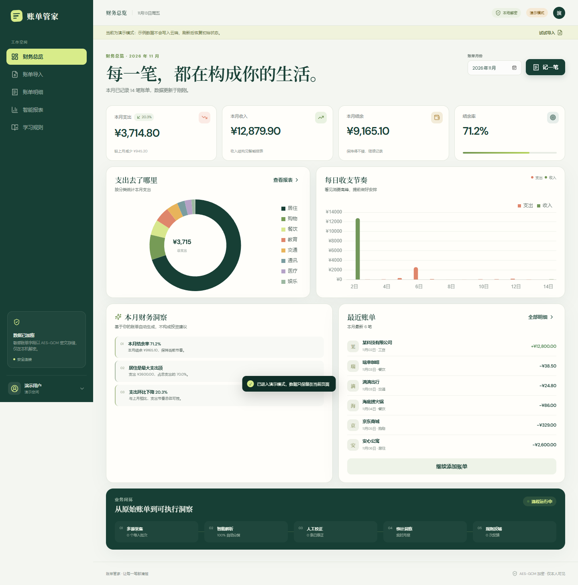 |

| 账单明细与修正 | 反馈学习 |
|---|---|
| 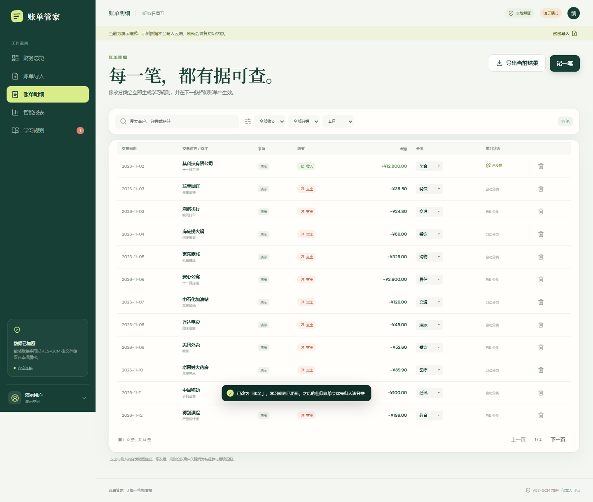 | 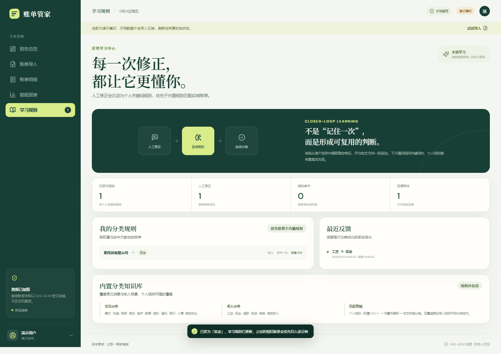 |

| 导入预览 | 智能月报 |
|---|---|
| 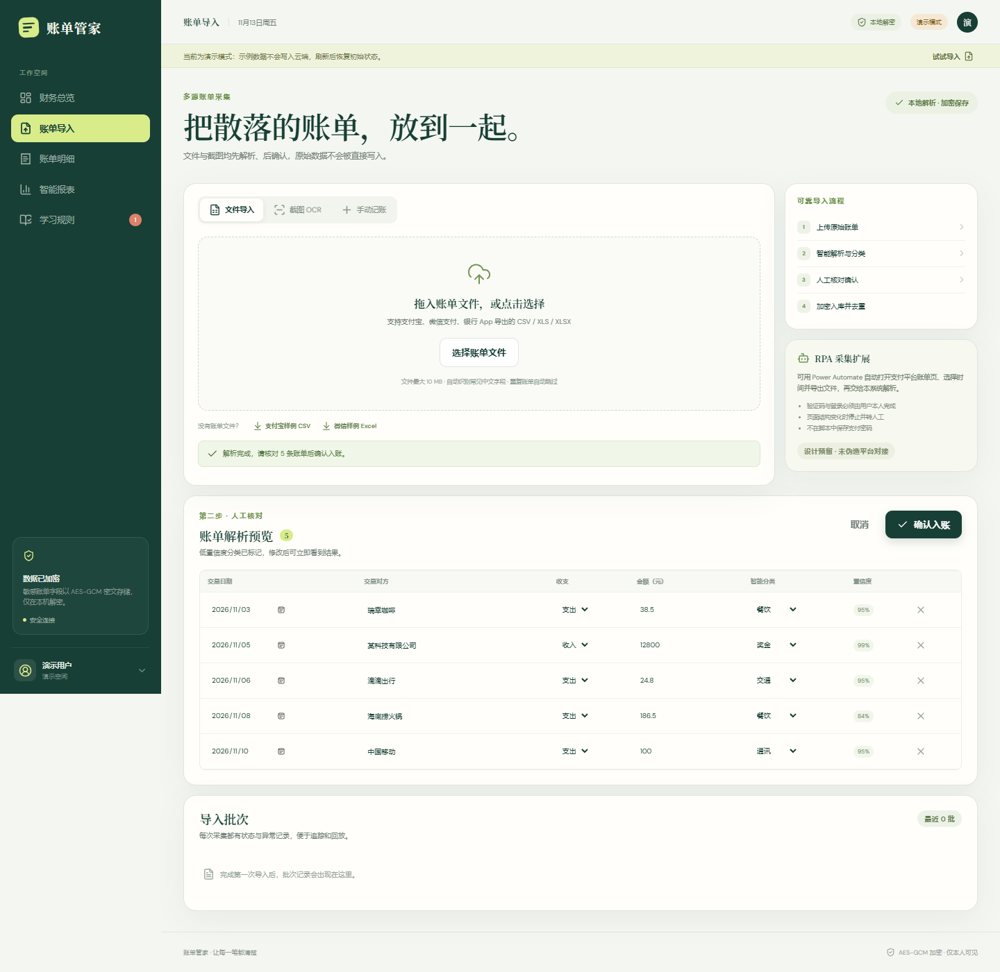 | 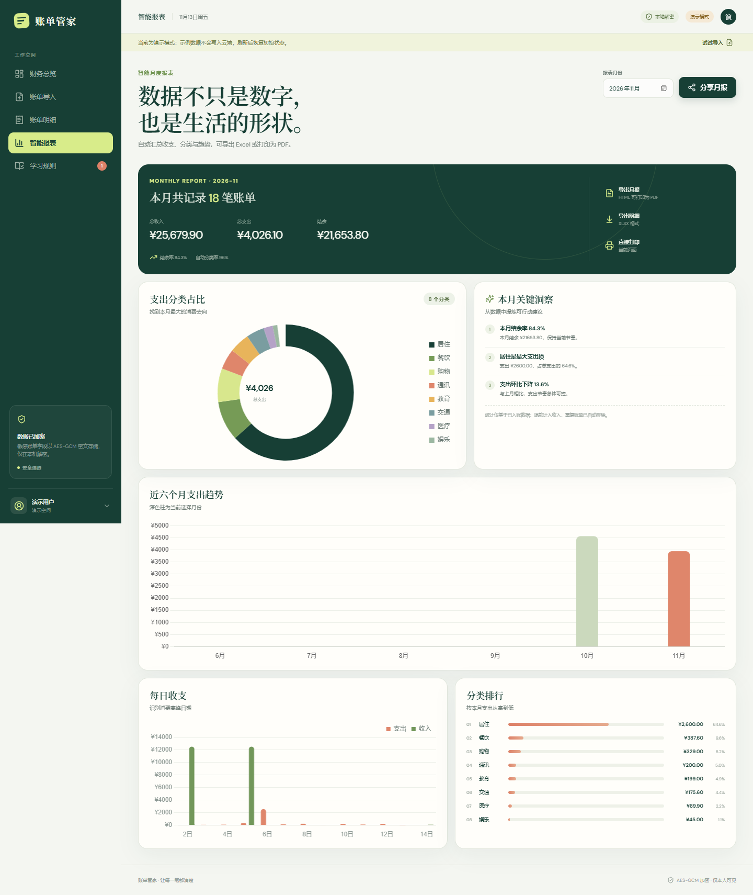 |

| 移动端 | OCR 导入 |
|---|---|
| 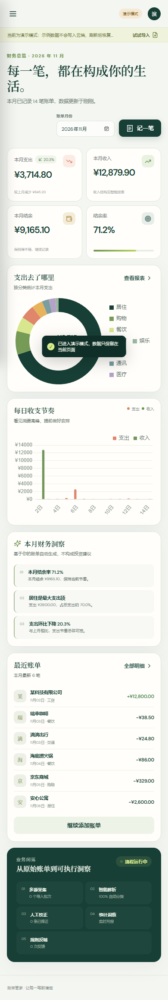 | 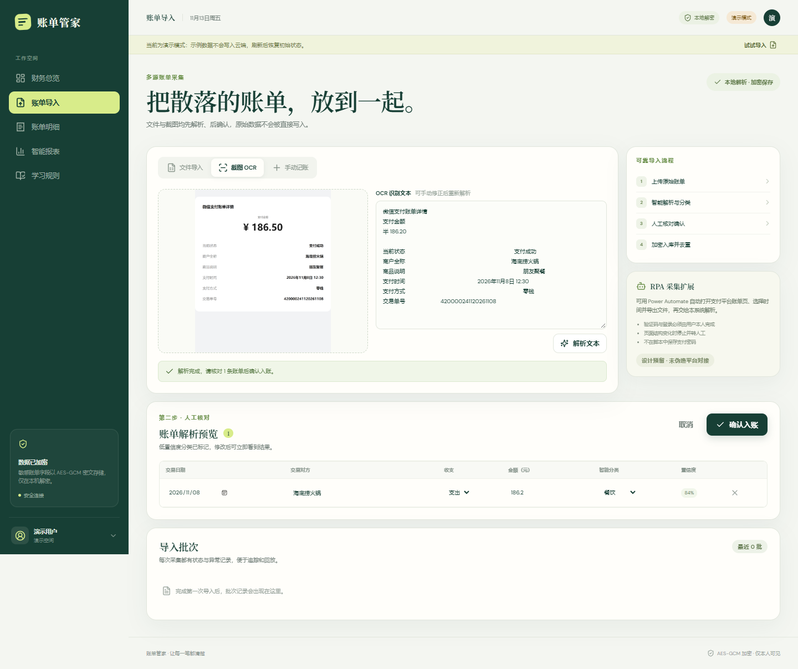 |

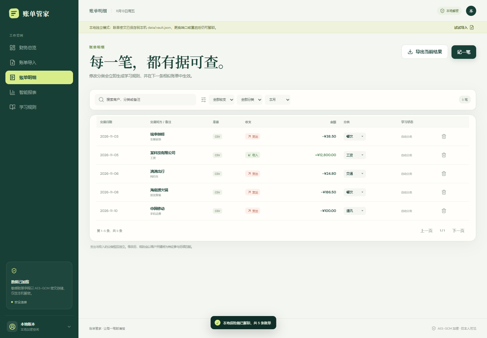

> 本地独立模式：账单与批次已入账，敏感字段在 `data/vault.json` 中保持密文。
